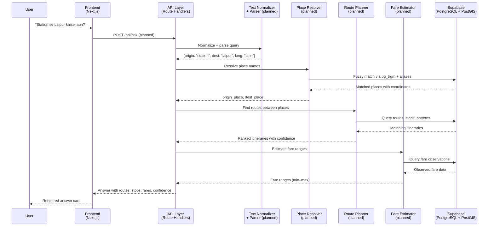
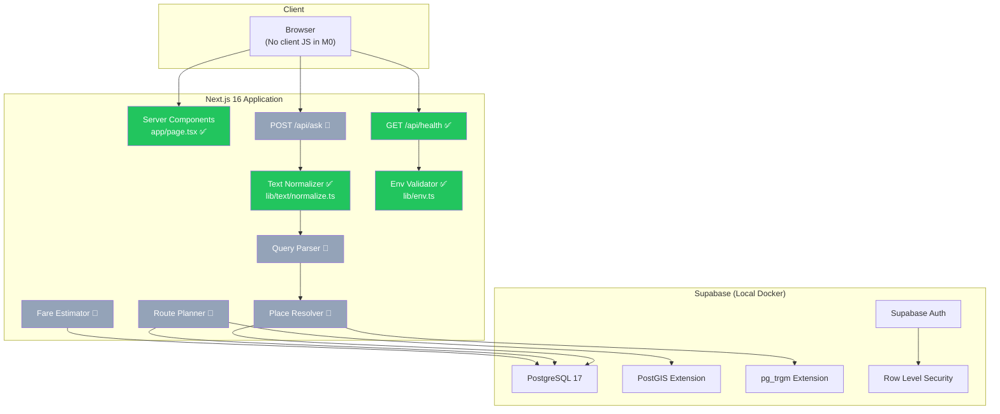
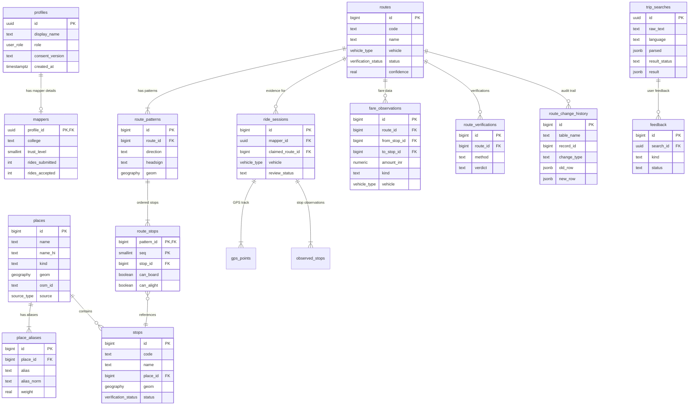

# SAWARI

**Shared auto and e-rickshaw navigation for Ranchi — in Hindi, Hinglish, and English.**

SAWARI helps people in Ranchi navigate shared autos and e-rickshaws through Hindi, Hinglish, and English queries, using a community-verified route database. Ask something like _"Station se Lalpur kaise jaun?"_ and get clear, sourced directions — not AI-generated guesses.

[](LICENSE)
[](https://nextjs.org/)
[](https://www.typescriptlang.org/)
[](https://supabase.com/)
[](https://postgis.net/)
[](https://tailwindcss.com/)

> **Status:** Project skeleton — milestones M0–M1 complete. The answer engine, route search, and AI features are **not yet implemented**. See [Current Implementation Status](#current-implementation-status) and [Development Roadmap](#development-roadmap).

---

## Table of Contents

- [Project Overview](#project-overview)
- [Problem Statement](#problem-statement)
- [How SAWARI Is Intended to Work](#how-sawari-is-intended-to-work)
- [Key Features and Capabilities](#key-features-and-capabilities)
- [Current Implementation Status](#current-implementation-status)
- [Architecture](#architecture)
- [Database Design](#database-design)
- [Development Roadmap](#development-roadmap)
- [Repository Structure](#repository-structure)
- [Installation and Local Setup](#installation-and-local-setup)
- [Environment Variables](#environment-variables)
- [Running the Development Server](#running-the-development-server)
- [Database Setup](#database-setup)
- [Available Scripts](#available-scripts)
- [Testing and Code Quality](#testing-and-code-quality)
- [Security and Data Integrity](#security-and-data-integrity)
- [Contributing](#contributing)
- [License](#license)

---

## Project Overview

Ranchi's shared autos and e-rickshaws have no published route maps, no apps, and no official stop listings. Riders rely on word-of-mouth, asking fellow passengers, or trial and error. SAWARI aims to change that by building a structured, community-verified database of routes, stops, and fares — and making it searchable in the languages people actually use.

When complete, a user will be able to ask a question and receive:

- **Where to board** — the nearest stand or landmark.
- **Which shared vehicle to take** — shared auto, e-rickshaw, or a combination.
- **Where to get off or change** — including transfer points for multi-leg trips.
- **Approximate fare ranges** — based on observed fares, never a single invented number.
- **Confidence notes** — how well-verified each piece of information is.

---

## Problem Statement

Ranchi has a dense network of shared autos and e-rickshaws, but no structured information about them exists. There are no route maps, stop names are informal (a chowk, a landmark, a college gate), fares vary, and the same destination is called different names in Hindi, Hinglish, and English.

**SAWARI's approach:**

1. Build a database of routes, stops, and fares from field research — volunteer rides, driver interviews, and OpenStreetMap data.
2. Require community verification before information is marked as reliable.
3. Let users query this database in natural language (Hindi, Hinglish, or English).
4. Never fabricate routes, stops, coordinates, or fares.

---

## How SAWARI Is Intended to Work

The following diagram shows the **planned** query flow from user input to answer. Components marked _(planned)_ are not yet implemented.



> **Note:** Only the text normalizer (`lib/text/normalize.ts`) and the health check API (`/api/health`) are implemented today. The parser, place resolver, route planner, fare estimator, and `/api/ask` endpoint are planned for milestones M2–M6.

---

## Key Features and Capabilities

### Implemented (M0–M1)

- **Trilingual text normalization** — NFC normalization, Devanagari detection, and script classification for Hindi, Hinglish, and English input.
- **Health check API** — `GET /api/health` reports application status and configuration completeness (names only, never secret values).
- **Environment validation** — Startup checks for Supabase and LLM configuration with safe reporting.
- **Placeholder UI** — Server-rendered Hinglish home page (zero client JavaScript) with disabled query input.
- **Database schema** — Complete PostgreSQL schema with PostGIS, Row Level Security, audit trails, and evidence tables.
- **Dark mode support** — Automatic light/dark theme via CSS custom properties.
- **Self-hosted fonts** — Noto Sans (Latin) and Noto Sans Devanagari, served locally without contacting Google Fonts.

### Planned (M2–M6)

- Place resolution with fuzzy matching via `pg_trgm` and place aliases.
- Hinglish/Hindi/English query parser (rule-based, with optional LLM assist).
- Route planner with multi-leg itineraries and transfer detection.
- Fare range estimation from community-observed data.
- Answer cards with confidence indicators and shareable links.
- Passenger feedback loop ("Sahi tha? / Galat hai?").

---

## Current Implementation Status

| Component | Status | Location |
|---|---|---|
| Home page (placeholder, server-rendered) | ✅ Implemented | `app/page.tsx` |
| Health check API | ✅ Implemented | `app/api/health/route.ts` |
| Environment validation | ✅ Implemented | `lib/env.ts` |
| Text normalization and script detection | ✅ Implemented | `lib/text/normalize.ts` |
| Unit tests (env + normalize) | ✅ Implemented | `tests/unit/` |
| Database migrations (5 migration files) | ✅ Implemented | `supabase/migrations/` |
| Tailwind CSS theme with dark mode | ✅ Implemented | `app/globals.css` |
| ESLint + TypeScript strict mode | ✅ Configured | `eslint.config.mjs`, `tsconfig.json` |
| Place resolver | 🔲 Planned (M2) | — |
| Query parser (`POST /api/ask`) | 🔲 Planned (M3) | — |
| Route planner | 🔲 Planned (M4) | — |
| Fare estimator | 🔲 Planned (M5) | — |
| Answer card UI | 🔲 Planned (M6) | — |
| Seed data (real routes/stops) | 🔲 Awaiting field research | `supabase/seed.sql` (intentionally empty) |

---

## Architecture

### System Architecture



**Legend:** 🟩 Green = implemented | 🔷 Grey = planned

### Technology Stack

| Layer | Technology | Purpose |
|---|---|---|
| Framework | Next.js 16 (Turbopack) | Server components, API routes, zero-JS placeholder pages |
| Language | TypeScript 5 (strict mode) | End-to-end type safety |
| Styling | Tailwind CSS 4 | Utility-first CSS with dark mode via custom properties |
| Database | PostgreSQL 17 (via Supabase) | Relational data with JSONB, audit triggers, RLS |
| Geospatial | PostGIS | Geography types, spatial indexes, distance queries |
| Fuzzy Search | pg_trgm | Trigram-based fuzzy matching for place name aliases |
| Validation | Zod 4 | Runtime schema validation for API inputs |
| Testing | Vitest 5 | Unit tests with TypeScript path alias support |
| Linting | ESLint 9 + eslint-config-next | Code quality and Next.js best practices |
| Local DB | Supabase CLI 3 + Docker | Local PostgreSQL with migrations, Studio UI |
| In-process DB | PGlite + PGlite-PostGIS | Lightweight PostgreSQL for testing (planned) |
| Fonts | Noto Sans + Noto Sans Devanagari | Self-hosted Latin and Devanagari typefaces |

---

## Database Design

The database schema is defined across five migration files and covers the full data model for community-verified transport information.

### Entity Relationship Diagram



### Schema Highlights

| Migration | Tables | Purpose |
|---|---|---|
| `000001` Extensions & Types | — | PostGIS, pg_trgm, enums (`vehicle_type`, `verification_status`, `source_type`, `user_role`) |
| `000002` People | `profiles`, `mappers` | Volunteer and reviewer accounts with RLS |
| `000003` Network Map | `places`, `place_aliases`, `stops`, `routes`, `route_patterns`, `route_stops` | The transport network with spatial indexes and trigram search |
| `000004` Evidence | `ride_sessions`, `gps_points`, `observed_stops`, `vehicle_sightings`, `fare_observations`, `route_verifications` | Append-only field data — never edited, only appended |
| `000005` Passenger & Audit | `trip_searches`, `feedback`, `events`, `route_change_history` | Search logs, feedback, analytics, and full change history with triggers |

### Verification Lifecycle

Every route and stop follows a strict verification status progression:

**reported** → **observed** (one accepted field ride) → **verified** (two independent accepted rides agree) → and can be marked **disputed**, **stale**, **suspended**, or **retired**.

---

## Development Roadmap

```mermaid
flowchart LR
    M0["<strong>M0: Project Setup</strong><br/>Next.js, TypeScript,<br/>Tailwind, ESLint,<br/>Vitest config"]
    M1["<strong>M1: Foundation</strong><br/>DB migrations, health API,<br/>text normalizer, env<br/>validation, placeholder UI"]
    M2["<strong>M2: Place Resolver</strong><br/>Fuzzy place matching,<br/>alias lookups,<br/>pg_trgm search"]
    M3["<strong>M3: Query Parser</strong><br/>Hinglish rule parser,<br/>POST /api/ask,<br/>optional LLM assist"]
    M4["<strong>M4: Route Planner</strong><br/>Multi-leg itineraries,<br/>transfers, confidence<br/>scoring"]
    M5["<strong>M5: Fare Ranges</strong><br/>Fare estimation from<br/>observed data,<br/>fare rules"]
    M6["<strong>M6: Answer Card</strong><br/>UI answer display,<br/>share page,<br/>feedback loop"]

    M0 --> M1 --> M2 --> M3 --> M4 --> M5 --> M6

    style M0 fill:#22c55e,color:#fff
    style M1 fill:#22c55e,color:#fff
    style M2 fill:#f59e0b,color:#fff
    style M3 fill:#94a3b8,color:#fff
    style M4 fill:#94a3b8,color:#fff
    style M5 fill:#94a3b8,color:#fff
    style M6 fill:#94a3b8,color:#fff
```



**Legend:** 🟩 Green = complete | 🟨 Amber = next up | 🔷 Grey = planned

| Milestone | Description | Status |
|---|---|---|
| **M0** | Project scaffolding — Next.js 16, TypeScript, Tailwind CSS, ESLint, Vitest | ✅ Complete |
| **M1** | Foundation — database schema, health API, text normalizer, environment validation, placeholder home page | ✅ Complete |
| **M2** | Place resolver — fuzzy matching of Hindi/Hinglish/English place names against the alias table using `pg_trgm` | 🔲 Next |
| **M3** | Query parser — Hinglish rule-based parser, `POST /api/ask` endpoint, optional LLM classification | 🔲 Planned |
| **M4** | Route planner — multi-leg itinerary computation with transfers, confidence scoring, walk edges | 🔲 Planned |
| **M5** | Fare ranges — estimation from observed fare data, percentile-based min–max ranges | 🔲 Planned |
| **M6** | Answer card — rendered itinerary display, shareable answer page, passenger feedback ("Sahi tha?") | 🔲 Planned |

---

## Repository Structure

```
sawari/
├── app/
│   ├── api/
│   │   └── health/
│   │       └── route.ts          # GET /api/health endpoint
│   ├── globals.css               # Tailwind theme, dark mode, font tokens
│   ├── layout.tsx                # Root layout (Noto Sans + Devanagari fonts)
│   ├── page.tsx                  # Placeholder home page (server component)
│   └── favicon.ico
├── lib/
│   ├── env.ts                    # Environment variable validation
│   └── text/
│       └── normalize.ts          # Query normalization + Devanagari detection
├── tests/
│   └── unit/
│       ├── env.test.ts           # Environment validation tests
│       └── normalize.test.ts     # Text normalization tests
├── supabase/
│   ├── migrations/
│   │   ├── ..._extensions_and_types.sql
│   │   ├── ..._people.sql
│   │   ├── ..._places_stops_routes.sql
│   │   ├── ..._evidence.sql
│   │   └── ..._passenger_and_audit.sql
│   ├── config.toml               # Local Supabase configuration
│   └── seed.sql                  # Intentionally empty (no invented data)
├── docs/
│   └── system-design/
│       └── reference-notes.md    # Architecture reference notes
├── public/                       # Static assets
├── .env.example                  # Environment variable template (no secrets)
├── .gitignore
├── eslint.config.mjs
├── next.config.ts
├── package.json
├── tsconfig.json
├── vitest.config.mts
└── LICENSE                       # MIT
```

---

## Installation and Local Setup

### Prerequisites

- **Node.js 24** or newer
- **npm** (included with Node.js)
- **Docker Desktop** — only needed for the local Supabase database (optional)

### Steps

1. **Clone the repository:**

   ```bash
   git clone https://github.com/webex042/SAWARI.git
   cd SAWARI
   ```

2. **Install dependencies:**

   ```bash
   npm install
   ```

3. **Create your local environment file:**

   ```bash
   cp .env.example .env.local
   ```

   The values can remain empty for now. The app runs without a database connection — the health check will report which settings are missing.

4. **Start the development server:**

   ```bash
   npm run dev
   ```

   Open [http://localhost:3000](http://localhost:3000) for the home page and [http://localhost:3000/api/health](http://localhost:3000/api/health) for the health check.

---

## Environment Variables

All environment variables are documented in [`.env.example`](.env.example). Copy it to `.env.local` — this file is git-ignored and never committed.

| Variable | Purpose | Required |
|---|---|---|
| `NEXT_PUBLIC_SUPABASE_URL` | Supabase API URL (local: `http://127.0.0.1:54321`) | For database features |
| `NEXT_PUBLIC_SUPABASE_ANON_KEY` | Supabase anonymous (publishable) key | For database features |
| `SUPABASE_SERVICE_ROLE_KEY` | Supabase service role key (**server only**) | For database features |
| `LLM_ENABLED` | Enable LLM features (`false` by default) | No |
| `GEMINI_API_KEY` | Gemini API key (required if `LLM_ENABLED=true`) | No |
| `GEMINI_MODEL` | Gemini model name (required if `LLM_ENABLED=true`) | No |
| `NEXT_PUBLIC_PMTILES_URL` | Map tiles path (future milestone) | No |
| `REVIEWER_EMAILS` | Comma-separated reviewer emails (future milestone) | No |

> **Security rule:** Variables prefixed with `NEXT_PUBLIC_` are sent to the browser. Secret keys (service role, Gemini API key) must **never** use this prefix.

---

## Running the Development Server

```bash
npm run dev
```

This starts the Next.js development server with Turbopack at [http://localhost:3000](http://localhost:3000). The page hot-reloads on file changes.

The home page is a **server component** — it renders to HTML on the server and sends zero JavaScript to the client.

---

## Database Setup

The local database runs via the Supabase CLI and Docker Desktop.

### Start the local database

```bash
npm run db:start
```

This starts a local PostgreSQL 17 instance with PostGIS, runs all migrations, and prints the connection URL and keys. Copy the printed `API URL`, `anon key`, and `service_role key` into your `.env.local`.

### Supabase Studio

The database admin dashboard is available at [http://localhost:54323](http://localhost:54323) after starting the database.

### Other database commands

| Command | Description |
|---|---|
| `npm run db:start` | Start local Supabase (PostgreSQL + Studio) |
| `npm run db:stop` | Stop the local database |
| `npm run db:status` | Show connection details and running services |
| `npm run db:reset` | Drop and rebuild from migrations + seed |

> **Note:** `seed.sql` is intentionally empty. SAWARI does not ship invented route data. Real data will come from field research, driver interviews, and OpenStreetMap imports.

---

## Available Scripts

| Script | Command | Description |
|---|---|---|
| Development server | `npm run dev` | Next.js dev server with Turbopack and hot reload |
| Production build | `npm run build` | Compile the production build |
| Production server | `npm start` | Serve the production build |
| Lint | `npm run lint` | Run ESLint |
| Type check | `npm run typecheck` | Generate Next.js route types, then run `tsc --noEmit` |
| Unit tests | `npm test` | Run all Vitest tests once |
| Watch tests | `npm run test:watch` | Re-run tests on file changes |
| Full check | `npm run check` | Lint + type check + tests (the project's local CI) |
| Start database | `npm run db:start` | Start local Supabase (requires Docker) |
| Stop database | `npm run db:stop` | Stop local Supabase |
| Database status | `npm run db:status` | Show local Supabase connection info |
| Reset database | `npm run db:reset` | Rebuild database from migrations |

---

## Testing and Code Quality

Run the full quality check:

```bash
npm run check
```

This executes, in order:

1. **ESLint** — code quality and Next.js best practices.
2. **TypeScript type check** — strict mode with `noEmit`, after generating Next.js route types.
3. **Vitest unit tests** — tests in `tests/unit/` covering environment validation and text normalization.

There are **no GitHub Actions**. All checks run locally on the developer's machine before commits.

### Current test coverage

| Test file | What it covers |
|---|---|
| `tests/unit/env.test.ts` | Missing settings detection, blank value handling, Supabase configuration status, LLM enable/disable logic, secret value exclusion |
| `tests/unit/normalize.test.ts` | Hinglish lowercasing, punctuation removal, whitespace collapsing, Hindi danda removal, Devanagari detection, script classification |

---

## Security and Data Integrity

### Core Principles

1. **No invented data.** The AI must never fabricate routes, stops, coordinates, or fares. All transport information comes from community-verified sources: field rides, driver interviews, OpenStreetMap, or official charts.

2. **Source provenance.** Every data record retains its `source_type` — how it was collected and by whom.

3. **Append-only evidence.** Field observations (rides, GPS points, fare observations) are never edited. A contradiction is recorded as a new row, not an overwrite.

4. **Row Level Security.** Every table has RLS enabled. Volunteers can only read and write their own data. Reviewers have broader read access. Passengers interact through the server API, which uses the service role.

5. **Audit trail.** All changes to routes, stops, and route patterns are recorded in `route_change_history` via database triggers.

6. **Verification lifecycle.** Routes progress through `reported → observed → verified` only through accepted field rides, never through bulk unverified reports.

7. **Secrets stay local.** `.env.local` is git-ignored. Secret keys never use the `NEXT_PUBLIC_` prefix. The health check reports setting names, never values.

8. **No automatic deployments.** There are no GitHub Actions, no CI/CD pipelines, and no automatic deploys. Deploying to production or pushing migrations to a hosted Supabase instance requires deliberate, manual approval.

---

## Contributing

SAWARI is in its early stages, and contributions are welcome.

### Getting started

1. Fork the repository.
2. Clone your fork and follow the [Installation and Local Setup](#installation-and-local-setup) instructions.
3. Create a feature branch from `main`.
4. Make your changes and ensure `npm run check` passes.
5. Submit a pull request with a clear description of what you changed and why.

### Guidelines

- Run `npm run check` (lint + typecheck + tests) before every commit.
- Do not invent Ranchi routes, stops, coordinates, or fares. Data must come from verifiable sources.
- Do not commit secrets, API keys, or `.env.local` files.
- Do not add GitHub Actions, automatic deployments, or hosted database migrations.
- Keep PRs focused — one feature or fix per pull request.

---

## License

[MIT](LICENSE) — see the license file for details.

Map data sourced from [OpenStreetMap](https://www.openstreetmap.org/) is © OpenStreetMap contributors, licensed under the [ODbL](https://opendatacommons.org/licenses/odbl/).
